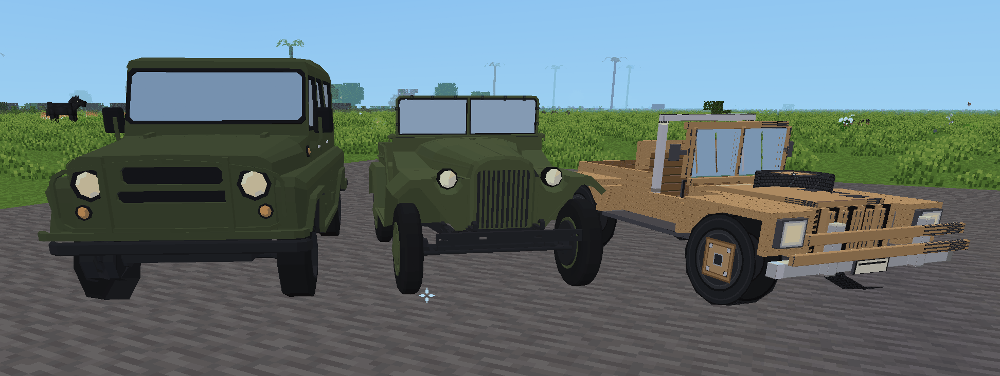

# 🚙 Off-Road Vehicles for Luanti / Minetest



> ### 🚧 Work in Progress but Playable
>
> **Conquer the Wilderness in Style.**  
> Four expedition off-roaders with **True Cruise Control**, **Independent 360° Freelook Steering**, **Two Seating Options**, and **Zero Mod Dependencies**:
> 1. **Safari Jeep (`safari_jeep:jeep`)**: Classic wooden expedition vehicle with front bullbar, hood spare wheel, rollbar, side shovel, and rear jerrycans.
> 2. **GAZ-67 (`safari_jeep:gaz67`)**: Open-top Soviet 4x4 military off-roader with olive-drab paint, exposed frame, and dual leather seats.
> 3. **UAZ-469 (`safari_jeep:uaz469`)**: Enclosed Soviet military vehicle with cabin enclosure (players are seated inside and seamlessly hidden from outside view).
> 4. **Classic 4x4 Jeep (`safari_jeep:jeep_4x4`)**: Iconic American 4x4 trail off-roader with roll cage, leather bucket seats, and rugged suspension.

[](#)
[](licence.md)
[](https://www.luanti.org)
[](#zero-dependencies)

---

## 🌟 Overview

Tired of holding down the `W` key across endless voxel continents? Frustrated by vehicles that jerk around every time you turn your head to enjoy the view?

Welcome to **Safari Jeep** — an expedition-grade off-road vehicle designed from the ground up for road trips, safari tours, and survival exploration in **Luanti / Minetest**.

Hop in, set your cruise speed, steer with authentic automotive controls, and bring a friend along for the ultimate scenic expedition!

---

## ✨ Features That Set You Free

### 🏎️ True Cruise Control (Set & Coast)
Forget cramped fingers! Safari Jeep features a realistic **throttle inertia / cruise control** system:
- Tap or hold **`[W]`** to accelerate and build speed.
- Tap or hold **`[S]`** to slow down, brake, or shift into reverse.
- **Release `[W]` and relax:** The Jeep maintains your forward cruising speed automatically! Cross vast savannas, deserts, and highways without holding a single key.
- Need to stop fast? Tap **`[Space]`** to engage the instant emergency handbrake!

### 🧭 Independent 360° Freelook Steering
Drive like you're behind the wheel of a real vehicle:
- Steer exclusively with **`[A]`** (turn left) and **`[D]`** (turn right).
- Your camera is **completely detached** from steering. Look anywhere — up at towering peaks, down into canyons, sideways at roaming wildlife, or back at your co-pilot — all while staying perfectly on course.

### 👥 Dual Seating: Bring Your Co-Pilot
Why explore alone when you can embark on a grand safari together?
- **Driver Seat (Left):** Takes the wheel, controls throttle, steering, and the horn.
- **Passenger Seat (Right):** Sits comfortably, enjoys the panoramic views, and snaps breathtaking screenshots.
- Smart boarding: The first player to right-click takes the wheel; a second player seamlessly takes the shotgun seat.

### 🏔️ Off-Road Terrain Traversal & Dynamic Slope Tilt
Built tough for rugged terrain:
- **1.25-Node Step Height:** Effortlessly scales 1-block steps, hillsides, riverbanks, and slopes without getting stuck.
- **Dynamic Slope Pitch:** Automatically pitches up when conquering steep climbs and tilts down when descending valleys.

### 🎨 Handcrafted Expedition Model & Audio Polish
- **Custom 3D Mesh:** Featuring warm wood-plank quarter panels, a heavy-duty front brush guard, dual red & grey expedition canisters, mounted safari shovel, roll bar, and dual leather upholstery seats.
- **Dynamic Exhaust Smoke:** Puffs of smoke trail realistically behind the tailpipe as you drive.
- **Dashboard HUD:** Real-time speedometer (km/h), gear indicator (`DRIVE (CRUISE)`, `REVERSE`, `PARK`), and quick control reminders.
- **Built-in Audio:** 4-cylinder engine loop and an authentic dual-tone safari horn triggered by left-clicking!
- **Safe Pick-up:** Sneak + Punch (`Shift + Left-Click`) on an empty Jeep instantly stows it back into your inventory.

---

## 🎮 Controls

| Key | Driver Action | Passenger Action |
|:---:|:---|:---|
| **`W`** | **Speed Up** (Accelerate throttle) | — |
| **`S`** | **Slow Down / Reverse** (Brake throttle) | — |
| **`A`** | **Steer Left** | — |
| **`D`** | **Steer Right** | — |
| **`Space`** | **Emergency Handbrake** (Rapid halt) | — |
| **`Left-Click`** | **Honk Horn** (*Beep Beep!*) | — |
| **`Shift` (Sneak)** | **Exit Vehicle** (Auto-parks safely to the left) | **Exit Vehicle** (Steps out safely to the right) |
| **Mouse Look** | **Free 360° Camera View** | **Free 360° Camera View** |

---

## 📦 Zero Dependencies

**Safari Jeep requires NO external mods, libraries, or frameworks.**  
It runs natively on pure Luanti / Minetest 5.0+ and adapts automatically to any game:
- Minetest Game (MTG)
- VoxeLibre (MineClone2)
- NodeCore
- Custom standalone Luanti servers

*(If the standard `default` mod is present, a balanced crafting recipe is automatically registered!)*

---

## 🛠️ Crafting Recipes

When playing in survival mode with the `default` mod active:

### 1. Safari Jeep (`safari_jeep:jeep`)
| Row | Item 1 | Item 2 | Item 3 |
|:---:|:---:|:---:|:---:|
| **Top** | Steel Ingot | Glass | Steel Ingot |
| **Middle** | Steel Ingot | Any Wood Planks | Steel Ingot |
| **Bottom** | Steel Ingot | Steel Ingot | Steel Ingot |

### 2. GAZ-67 (`safari_jeep:gaz67`)
| Row | Item 1 | Item 2 | Item 3 |
|:---:|:---:|:---:|:---:|
| **Top** | Steel Ingot | Glass | Steel Ingot |
| **Middle** | Any Wood Planks | Steel Ingot | Any Wood Planks |
| **Bottom** | Steel Ingot | Steel Ingot | Steel Ingot |

### 3. UAZ-469 (`safari_jeep:uaz469`)
| Row | Item 1 | Item 2 | Item 3 |
|:---:|:---:|:---:|:---:|
| **Top** | Steel Ingot | Glass | Steel Ingot |
| **Middle** | Steel Ingot | Glass | Steel Ingot |
| **Bottom** | Steel Ingot | Steel Ingot | Steel Ingot |

### 4. Classic 4x4 Jeep (`safari_jeep:jeep_4x4`)
| Row | Item 1 | Item 2 | Item 3 |
|:---:|:---:|:---:|:---:|
| **Top** | Steel Ingot | Glass | Steel Ingot |
| **Middle** | Any Wool | Steel Ingot | Any Wool |
| **Bottom** | Steel Ingot | Steel Ingot | Steel Ingot |

> **Creative & Admin Commands:**  
> - `/giveme safari_jeep:jeep`
> - `/giveme safari_jeep:gaz67`
> - `/giveme safari_jeep:uaz469`
> - `/giveme safari_jeep:jeep_4x4` (or `/giveme safari_jeep:classic_jeep`)

---

## 🚀 Installation

1. Download or clone this repository into your Luanti `mods/` directory:
   ```bash
   cd ~/.minetest/mods/   # (or your Luanti mods folder)
   git clone https://github.com/ronrob-lu/safari-jeep.git
   ```
2. Enable `safari_jeep` in your world configuration or server `world.mt`.
3. Launch Luanti, craft your Jeep, place it on the ground, and start your expedition!

---

## 📄 License & Credits

Distributed under the **MIT License**. See [`licence.md`](licence.md) for full terms.  
Copyright (c) 2026 **ronrob-lu**.

### 🚙 Vehicle 3D Models & Credits

- **Standard Safari Jeep** - licence CC0  Gemini 3.8 prompted by ronrob-lu
- **UAZ 469** - CC0 by artie31
- **GAZ 67** - CC0 by artie31
- **Generic Green Jeep** - CC0 by Daniel Quevedo

